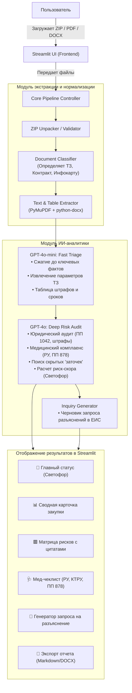

# 📋 План реализации: TenderAI Med (MVP)

> **Цель:** Создать работающий MVP ИИ-анализатора тендерной документации (44-ФЗ / 223-ФЗ) для поставщиков медицинского оборудования, который за 60 секунд выявляет критические риски, проверяет медицинские требования (РУ, КТРУ, нацрежим ПП 878) и формирует черновик запроса на разъяснение.

---

## Описание цели и контекст

### Проблема целевой аудитории (Поставщики медицинского оборудования)
Поставщики сложной медтехники (УЗИ, МРТ, эндоскопы, ИВЛ, расходные материалы) тратят по 3–5 часов на ручную вычитку одного комплекта документации из 50–200 страниц. В этой нише типичны:
- **«Заточки» под конкретного производителя:** Невыполнимые узкие характеристики в ТЗ.
- **Риск отклонения заявки по нацрежиму:** Незнание актуальных ограничений по ст. 14 44-ФЗ и Постановлению Правительства РФ № 878 (реестр радиоэлектроники Минпромторга).
- **Скрытые ловушки контракта:** Кабальные штрафы сверх ПП РФ № 1042, нереалистичные сроки поставки (например, 5 дней на тяжелое оборудование), навязанные бесплатные сервисные работы.
- **Обязательность РУ:** Требования к действующим Регистрационным удостоверениям Росздравнадзора.

### Решение
Автономный сервис, куда пользователь загружает архив (ZIP) или файлы (PDF / DOCX), а система:
1. Автоматически извлекает и структурирует текст (ТЗ + Проект контракта).
2. Анализирует документ связкой **GPT-4o-mini** (быстрая фильтрация и извлечение таблиц) + **GPT-4o** (глубокий скоринг рисков и нормативный комплаенс).
3. Выдаёт интуитивный UI на **Streamlit** с принципом «Светофор» (🟢/🟡/🔴), детализированной матрицей рисков с точными цитатами и кнопкой создания запроса на разъяснение.

---

## Требуется подтверждение пользователя

> [!IMPORTANT]
> **Ключевые решения, заложенные в план:**
> 1. **OpenAI API Key:** Для работы потребуется действующий ключ OpenAI с доступом к моделям `gpt-4o-mini` и `gpt-4o`. Если потребуется локальный прокси или альтернативный ключ — предусмотрим гибкую настройку через `.env`.
> 2. **Архитектура:** Единый проект на Python: бэкенд-модули (бизнес-логика, парсеры, агенты) + фронтенд на Streamlit. Это исключает сложность раздельного деплоя на старте.
> 3. **Нишевый фокус:** Модуль анализа жестко калибруется под нормативную базу медзакупок:
>    - Ст. 14 44-ФЗ и ПП РФ № 878 (ограничение допуска иностранной радиоэлектроники / медизделий).
>    - Требования к Регистрационным удостоверениям (РУ Росздравнадзора).
>    - КТРУ и правила описания объекта закупки по ст. 33 44-ФЗ.
>    - Правила исчисления неустоек по ПП РФ № 1042.

---

## Открытые вопросы

> [!NOTE]
> На этапе реализации потребуется подтвердить:
> - Есть ли у вас уже готовый API-ключ OpenAI, либо настроим тестовый мок-режим (демо-данные без списания токенов для проверки верстки и логики)?
> - Есть ли 1–2 реальных примера архивов/файлов закупок с zakupki.gov.ru для калибровки и тестов (или мы сгенерируем реалистичный синтетический образец медоборудования)?

---

## Архитектура системы



---

## Структура файлов проекта

```
Tender/
├── .env.example                  # Образец переменных окружения (OPENAI_API_KEY и т.д.)
├── .env                          # Локальный файл с секретами (в .gitignore)
├── .gitignore                    # Игнорирование venv, кэша, логов, .env
├── requirements.txt              # Зависимости проекта
├── README.md                     # Подробная инструкция по запуску
├── app/
│   ├── __init__.py
│   ├── config.py                 # Настройки через Pydantic BaseSettings
│   ├── models/
│   │   ├── __init__.py
│   │   └── schemas.py            # Pydantic-модели валидации входных и выходных данных
│   ├── services/
│   │   ├── __init__.py
│   │   ├── extractor.py          # Распаковка ZIP, чтение PDF/DOCX
│   │   ├── classifier.py         # Определение типа документа (ТЗ vs Контракт)
│   │   ├── prompts.py            # Специализированные системные промпты по 44-ФЗ и медтехнике
│   │   ├── llm_service.py        # Клиент OpenAI (gpt-4o-mini, gpt-4o) с Structured Outputs
│   │   └── analyzer.py           # Оркестратор анализа и генерации запросов
│   └── utils/
│       ├── __init__.py
│       └── export.py             # Генерация отчета на выгрузку (Markdown / DOCX)
├── ui/
│   ├── __init__.py
│   └── app.py                    # Главное приложение Streamlit
├── tests/
│   ├── __init__.py
│   ├── test_extractor.py         # Тесты чтения файлов
│   ├── test_classifier.py        # Тесты классификации
│   └── test_schemas.py           # Тесты валидации Pydantic
└── sample_data/
    └── sample_med_tender.md      # Эталонный тестовый образец ТЗ на поставку УЗИ-аппарата
```

---

## Пошаговый план реализации (Bite-Sized Tasks)

### Этап 1: Окружение и базовая конфигурация

#### [NEW] `requirements.txt`
```text
streamlit>=1.38.0
pydantic>=2.8.0
pydantic-settings>=2.4.0
openai>=1.40.0
pymupdf>=1.24.0
python-docx>=1.1.0
python-dotenv>=1.0.1
pytest>=8.3.0
```

#### [NEW] `.env.example`
```ini
OPENAI_API_KEY=your_openai_api_key_here
OPENAI_MODEL_CHEAP=gpt-4o-mini
OPENAI_MODEL_SMART=gpt-4o
MOCK_MODE=False
```

#### [NEW] `app/config.py`
Настройки приложения через `pydantic-settings` с валидацией наличия ключей и поддержкой `MOCK_MODE` (для тестирования без расхода токенов).

---

### Этап 2: Pydantic-схемы данных (Строгая типизация отчетов)

#### [NEW] `app/models/schemas.py`
Создание строгих схем для Structured Outputs от OpenAI:
- `RiskLevel`: Enum (`CRITICAL`, `WARNING`, `INFO`, `SAFE`)
- `TrafficLight`: Enum (`GREEN`, `YELLOW`, `RED`)
- `RiskItem`: Категория (Юридический, Технический, Медицинский, Финансовый), заголовок, описание, цитата из документа, ссылка на закон (например, ПП 1042 или ст. 14 44-ФЗ), рекомендация.
- `MedCompliance`: Проверка РУ (требуется/указано), Нацрежим по ПП 878 («третий лишний» / реестровые записи), соответствие КТРУ, эквивалентность характеристик.
- `TenderSummary`: Предмет закупки, НМЦК, срок поставки, аванс, размер обеспечения заявки и контракта, место поставки.
- `ClarificationRequest`: Тема, нормативное обоснование, проект формулировки запроса заказчику в ЕИС.
- `FullAnalysisReport`: Итоговый объект, объединяющий все секции, общий вердикт (Светофор) и краткое резюме для руководителя.

---

### Этап 3: Модуль извлечения документов (Extractor)

#### [NEW] `app/services/extractor.py`
- Поддержка форматов: `.zip`, `.pdf`, `.docx`.
- Безопасная распаковка ZIP в изолированный временный каталог (защита от Path Traversal).
- Извлечение текста из DOCX с сохранением структуры параграфов и базовых таблиц.
- Извлечение текста из текстовых PDF через `pymupdf` (быстро, без GPU).
- Проверка на пустые/сканированные документы с информативным уведомлением пользователя.

#### [NEW] `app/services/classifier.py`
Эвристический классификатор:
- Сканирует заголовки и первые 500 слов каждого документа.
- Присваивает роль:
  - `TECH_SPEC`: Техническое задание, описание объекта закупки, спецификация.
  - `CONTRACT_DRAFT`: Проект контракта, договор поставки.
  - `INFO_CARD`: Требования к содержанию заявки, информационная карта.
  - `OTHER`: Прочие приложения (обоснование НМЦК, проект гарантии).

---

### Этап 4: Промпт-инжиниринг под медицинские закупки

#### [NEW] `app/services/prompts.py`
Создание 3 специализированных системных промптов:
1. **Промпт Triage (gpt-4o-mini):**
   - Быстрое сканирование текста, удаление формальных положений, извлечение числовых параметров (НМЦК, сроки, пени, обеспечение), составление структурированной выжимки для экономии токенов.
2. **Промпт Deep Med Audit (gpt-4o):**
   - Фокус на медицинские особенности:
     - Ограничение конкуренции по ст. 33 44-ФЗ (наличие взаимоисключающих параметров, подогнанных под одного вендора: например, габариты датчика + специфическая частота, встречающиеся только у Mindray или GE).
     - Регистрационные удостоверения (РУ Росздравнадзора) — корректность формулировок.
     - ПП РФ № 878 / Приказ Минфина 126н / ст. 14 — риски отклонения отечественными/евразийскими аналогами.
     - Штрафы по ПП РФ № 1042 — завышенные пени (более 1/300 ставки ЦБ РФ) или фиксированные штрафы, противоречащие закону.
     - Сроки: требование поставки высокотехнологичного оборудования в нереалистичные сроки.
3. **Промпт Clarification Builder:**
   - Формирование вежливого, но юридически жесткого запроса на разъяснение положений извещения с цитатами законов (ч. 4 ст. 65 44-ФЗ, 135-ФЗ «О защите конкуренции»).

---

### Этап 5: Сервис оркестрации ИИ (LLM Service & Analyzer)

#### [NEW] `app/services/llm_service.py`
- Инкапсуляция вызовов OpenAI API.
- Использование метода `beta.chat.completions.parse` (Structured Outputs) для гарантированного получения валидного JSON по схеме `FullAnalysisReport`.
- Встроенный Mock-режим: при отсутствии ключа или флаге `MOCK_MODE=True` возвращает реалистичный детальный отчет по закупке УЗИ-аппарата для демонстрации и отладки без затрат.

#### [NEW] `app/services/analyzer.py`
- Связывает экстрактор, классификатор и LLM в единый конвейер.
- Считает время анализа и статистику по объему обработанных документов.

---

### Этап 6: Пользовательский интерфейс Streamlit

#### [NEW] `ui/app.py`
Разработка современного UI:
- **Боковая панель:**
  - Ввод/статус OpenAI API Key.
  - Переключатель режимов (Живой анализ / Демо-режим).
  - Справка по поддерживаемым законам (44-ФЗ, ПП 878, ПП 1042).
- **Главный экран (Dropzone):**
  - Загрузка ZIP-архива с закупкой или перетаскивание нескольких PDF/DOCX файлов.
  - Кнопка «Запустить ИИ-экспертизу».
- **Индикатор статуса (Progress Bar):**
  - Шаг 1: Распаковка и классификация файлов.
  - Шаг 2: Извлечение условий контракта и ТЗ.
  - Шаг 3: Аудит рисков и нормативный скрининг.
  - Шаг 4: Формирование отчета.
- **Экран результатов (Дашборд):**
  - **Баннер вердикта:**
    - 🟢 **РЕКОМЕНДОВАНО К УЧАСТИЮ** (Минимальные риски, типовые условия)
    - 🟡 **ВНИМАНИЕ: ЕСТЬ СУЩЕСТВЕННЫЕ РИСКИ** (Требуются разъяснения или расчет)
    - 🔴 **СТОП-ФАКТОРЫ: ВЫСОКИЙ РИСК ПОТЕРИ ДЕНЕГ / РНП**
  - **Информационные карточки метрик:** НМЦК, Срок поставки, Аванс, Обеспечение.
  - **Вкладка 1: Матрица рисков.** Карточки рисков с цветными бейджами, точными цитатами из ТЗ/контракта и статьями законов.
  - **Вкладка 2: Медицинский комплаенс.** Анализ РУ, статус по ПП 878 (нацрежим), требования к пусконаладке и сервису.
  - **Вкладка 3: Запрос заказчику в ЕИС.** Готовый текст запроса с кнопкой «Скопировать в буфер обмена».
  - **Вкладка 4: Спецификация оборудования.** Извлеченная таблица характеристик из ТЗ.
  - **Кнопка скачивания отчета:** Сохранение в Markdown / TXT.

---

### Этап 7: Тестирование и верификация (TDD)

#### [NEW] `tests/test_extractor.py`
- Тест распаковки ZIP с файлами разной вложенности.
- Тест извлечения текста из DOCX и PDF.

#### [NEW] `tests/test_schemas.py`
- Тест валидации Pydantic схемы `FullAnalysisReport` на корректных и некорректных JSON-структурах.

#### [NEW] `sample_data/sample_med_tender.md`
- Тестовые данные с искусственно заложенными «ловушками» для калибровки точности модели:
  - Ловушка 1: Пени 0.5% за каждый день (нарушение ПП РФ 1042).
  - Ловушка 2: Срок поставки МРТ 3 дня.
  - Ловушка 3: Требование поставки оборудования без предоставления РУ на этапе подачи (противоречие ст. 31 44-ФЗ).
  - Ловушка 4: Заточка под конкретную модель датчика без фразы «или эквивалент».

---

## План верификации

### Автоматические тесты
```bash
# Запуск юнит-тестов парсеров и валидации схем
pytest tests/ -v
```

### Ручное тестирование
1. Запуск приложения:
   ```bash
   streamlit run ui/app.py
   ```
2. Тестирование сценария Демо-режима:
   - Открыть страницу в браузере (`http://localhost:8501`).
   - Нажать кнопку «Загрузить тестовый образец (Закупка УЗИ-аппарата)».
   - Проверить, что светофор отображает 🔴 КРИТИЧЕСКИЙ РИСК, а в матрице рисков четко подсвечены заложенные ловушки (пени 0.5%, срок 3 дня).
   - Скопировать сгенерированный запрос на разъяснение.
3. Тестирование с реальным ZIP-архивом:
   - Загрузить реальный архив с zakupki.gov.ru.
   - Убедиться, что время анализа не превышает 60–90 секунд.
   - Проверить читаемость отчета.
