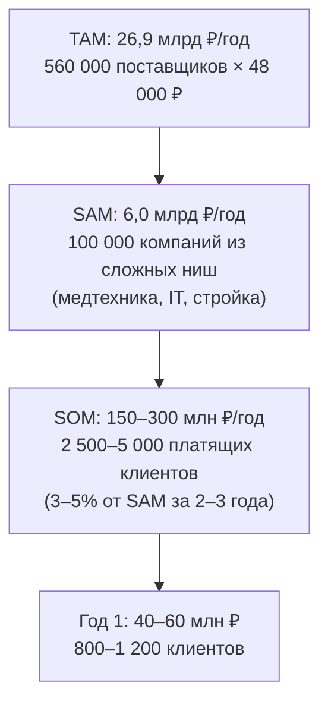
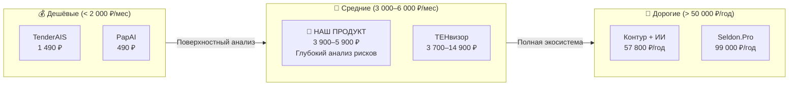
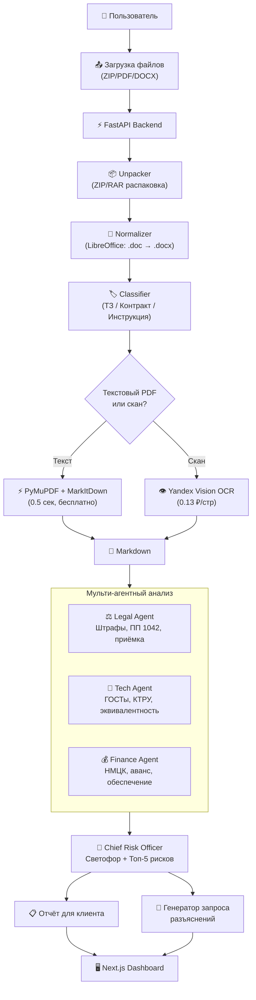
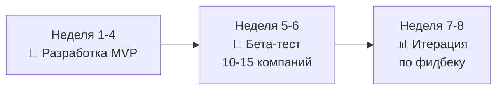

# 🎯 Вердикт: ИИ-анализатор тендерной документации — Полное исследование

> **Дата:** октябрь 2026  
> **Продукт:** B2B SaaS — ИИ-ассистент для анализа тендерной документации (44-ФЗ / 223-ФЗ)  
> **Целевая выручка:** 300 000 – 500 000 ₽/мес.

---

## 📊 ВЕРДИКТ (TL;DR)

> [!IMPORTANT]
> **Да, проект реален. Но не в том виде, как описано изначально.**
> 
> - 💰 **Выход на 400к/мес** — реалистичен за **6–9 месяцев**, но не за 2 недели
> - 🎯 **Целевой чек** — не 20 000 ₽/мес, а **3 900 – 5 900 ₽/мес** (попадает в порог самостоятельного согласования)
> - 👥 **Нужно клиентов** — не 20, а **70–130 компаний** (при реалистичном ARPU)
> - 🔧 **Себестоимость обработки 1 тендера** — всего **~15 ₽** (LLM + OCR)
> - 🏗️ **Бюджет инфраструктуры MVP** — **~15 000 ₽/мес** (не требует GPU)
> - ⚔️ **Конкуренция** — плотная, но ни у кого нет «убийственного» продукта для глубокого анализа рисков

### Шкала уверенности

| Параметр | Оценка | Комментарий |
|:---|:---:|:---|
| Наличие реального спроса | ⭐⭐⭐⭐⭐ | Подтверждено Wordstat (+400-600% рост), поведением в Telegram-сообществах, выходом крупных игроков (Контур, СБИС) |
| Техническая реализуемость MVP | ⭐⭐⭐⭐⭐ | Стек зрелый, себестоимость копеечная, 4 недели до работающего прототипа |
| Достижимость 400к/мес | ⭐⭐⭐⭐ | Реально, но требует 70-130 клиентов, а не 20 |
| Защита от «просто закинуть в ChatGPT» | ⭐⭐⭐⭐ | Конвейер парсинга + мульти-агенты + отраслевые шаблоны — то, чего нет у голого LLM |
| Конкурентные риски | ⭐⭐⭐ | Рынок плотный, крупные игроки уже добавляют ИИ в свои продукты |
| Маркетинг и продажи | ⭐⭐⭐ | B2B-продажи — длинный цикл, требует демо и прямых контактов |

---

## 1. РАЗМЕР РЫНКА — Конкретные цифры

### 1.1. Объём госзакупок РФ

| Сегмент | 2024–2025 (факт/оценка) |
|:---|:---|
| **44-ФЗ (Госзакупки)** | **~12 трлн ₽** (~3,58 млн контрактов) |
| **223-ФЗ (Госкомпании, открытый контур)** | **~8–9 трлн ₽** |
| **Коммерческие закупки (B2B)** | **~30 трлн ₽** |
| **Итого регулируемый сектор** | **~48–50 трлн ₽/год** |

### 1.2. Количество поставщиков

| Категория | Количество |
|:---|:---|
| Зарегистрированы в ЕРУЗ (ЕИС) | **560 000 – 600 000** |
| Активные участники (≥1 заявки/год) | **300 000 – 350 000** |
| **«Ядро» — регулярные участники (5–10+ заявок/год)** | **80 000 – 120 000** |
| Тендерные агентства и консультанты | **3 000 – 5 000** |
| Тендерные специалисты (на стороне поставщиков) | **150 000 – 250 000 человек** |

### 1.3. TAM / SAM / SOM

> [!NOTE]
> **SOM 150–300 млн ₽/год** — это потолок через 2–3 года при агрессивном росте. Цель **400к/мес (4,8 млн ₽/год)** — это менее **0,1% от SAM**. Абсолютно достижимо.

---

## 2. КОНКУРЕНТНЫЙ ЛАНДШАФТ — Кто уже на рынке

### 2.1. Тяжеловесы (Не наши прямые конкуренты)

| Игрок | Что делают | Цена | Почему не угрожают нам |
|:---|:---|:---|:---|
| **Контур.Закупки** | Поиск + мониторинг + теперь ИИ-ассистент | 16 000 – 57 800 ₽/год | Комбайн. ИИ — вспомогательная функция, не глубокий анализ |
| **СБИС Закупки** | Поиск + аналитика конкурентов | ~20 000 ₽/год | Фокус на мониторинг, не на разбор ТЗ |
| **Seldon.Pro** | Аналитика заказчиков, BI-дашборды | 69 000 – 99 000 ₽/год | Аналитика «вокруг» тендера, не «внутри» документации |

### 2.2. Прямые конкуренты (ИИ для тендеров)

| Игрок | Фокус | Цена | Сильные стороны | Слабости |
|:---|:---|:---|:---|:---|
| **ТЕНвизор** (tenvizor.ru) | CRM + ИИ-ассистент + расчёт себестоимости | 3 700 – 14 900 ₽/мес | Широкий охват, считает экономику | Перегруженный комбайн |
| **Тендерит** (tender-it.ru) | Сличение ТЗ с прайсом, подбор аналогов | Не опубликована | Бьёт в главную боль поставщиков | Узкий фокус на товарные поставки |
| **TenderAIS** | AI-анализ ТЗ + скоринг + канбан-CRM | 1 490 – 1 700 ₽/мес | Низкий чек, быстрый вход | Поверхностный анализ за эти деньги |
| **PapAI Soft** | Базовый AI-анализ | от 490 ₽/мес | Микро-чек | Минимальная глубина |
| **Tender-AI** (tender-ai.tech) | AI-агрегатор | Не ясна | Молодой проект | Не захватил выдачу |
| **Tenderama** (tenderama.ru) | Нишевый агрегатор | Не ясна | - | Молодой, без явных преимуществ |

### 2.3. Карта позиционирования

> [!TIP]
> **Наша ниша — «золотая середина»:** Глубже, чем TenderAIS за 1 500 ₽, но проще и дешевле, чем комбайны Контура/ТЕНвизора. Мы не продаём поиск тендеров — мы продаём **«анти-краш анализ»** того тендера, который клиент уже нашёл.

---

## 3. ЦЕНОВАЯ СТРАТЕГИЯ — Реалистичная модель

### 3.1. Почему 20 000 ₽/мес не сработает

| Фактор | Реальность |
|:---|:---|
| TenderAIS стоит 1 490 ₽/мес | Ваш продукт в **13 раз дороже** самого похожего аналога |
| Контур.Закупки + ИИ стоит ~4 800 ₽/мес | Даже Контур с брендом и экосистемой берёт меньше |
| Порог согласования без директора | В большинстве компаний расходы до 5 000 ₽/мес согласует линейный руководитель |
| Средний ARPU тендерного SaaS в РФ | **~4 000 – 5 000 ₽/мес** |

### 3.2. Рекомендуемые тарифы

| Тариф | Цена | Что входит | Целевой клиент |
|:---|:---|:---|:---|
| **Старт** (Freemium) | **0 ₽** | 3 анализа ТЗ в месяц, базовый светофор | Пробный вход, вирусный рост |
| **Профи** | **3 900 ₽/мес** | 30 анализов, полная матрица рисков, генератор запросов разъяснений | Малый бизнес, 1 тендерщик |
| **Команда** | **5 900 ₽/мес** | 100 анализов, 3 рабочих места, API, отраслевые шаблоны (мед/строй/IT) | Средний бизнес, тендерный отдел |
| **Агентство** | **14 900 ₽/мес** | Безлимит, white-label, мультибренд | Тендерные консультанты и аутсорсеры |

### 3.3. Путь к 400 000 ₽/мес

| Сценарий | Клиентов | ARPU | MRR |
|:---|:---:|:---:|:---:|
| Консервативный | 80 | 5 000 ₽ | **400 000 ₽** |
| Базовый | 65 | 6 200 ₽ | **403 000 ₽** |
| Оптимистичный | 50 | 8 000 ₽ | **400 000 ₽** |

> [!IMPORTANT]
> **65–80 платящих компаний** — это реалистичная цель на **6–9 месяцев** при правильном маркетинге. Из 80 000–120 000 «ядра» регулярных участников нужно конвертировать всего **0,05–0,1%**.

---

## 4. ЮНИТ-ЭКОНОМИКА — Себестоимость vs. Выручка

### 4.1. Стоимость обработки 1 тендера

| Компонент | Стоимость |
|:---|:---|
| **LLM API** (Gemini Flash фильтрация + Claude/GigaChat анализ рисков) | **~10–15 ₽** |
| **OCR** (Yandex Vision, только для сканов — ~25% документов) | **~2–5 ₽** |
| **Парсинг и хранение** (CPU, S3) | **~1–2 ₽** |
| **ИТОГО себестоимость 1 анализа** | **~13–22 ₽** |

### 4.2. Маржинальность на 1 клиента (тариф «Профи» — 3 900 ₽/мес)

| Метрика | Значение |
|:---|:---|
| Выручка с клиента | 3 900 ₽/мес |
| Средний расход тендеров | ~20 анализов/мес |
| Переменные расходы (20 × 18 ₽) | ~360 ₽/мес |
| **Gross Margin** | **~91%** |

### 4.3. P&L при 80 клиентах (целевой MRR 400 000 ₽)

| Статья | Сумма/мес |
|:---|:---|
| **Выручка** | **400 000 ₽** |
| LLM API (1 600 анализов × 15 ₽) | –24 000 ₽ |
| OCR (400 сканов × 5 ₽) | –2 000 ₽ |
| Сервер (VPS 4 vCPU / 16 GB) | –4 500 ₽ |
| S3 хранилище | –350 ₽ |
| Домен / SSL / DNS | –150 ₽ |
| Прокси (если парсим ЕИС) | –2 000 ₽ |
| **Итого расходы** | **~33 000 ₽** |
| **Чистая прибыль** | **~367 000 ₽ (~92%)** |

> [!TIP]
> Маржинальность **90%+** — это преимущество SaaS на LLM API. Основные затраты на масштабирование — маркетинг и продажи, а не инфраструктура.

---

## 5. ТЕХНИЧЕСКАЯ АРХИТЕКТУРА MVP — Что именно строим

### 5.1. Архитектура системы

### 5.2. Стек технологий

| Слой | Технология | Почему |
|:---|:---|:---|
| **Backend** | FastAPI (Python) | Async, быстрый, нативная интеграция с LLM-библиотеками |
| **Очередь задач** | Redis + Celery | Асинхронная обработка тяжёлых документов |
| **БД** | PostgreSQL + pgvector | Единая БД для данных и векторного поиска |
| **Парсинг PDF** | PyMuPDF + IBM Docling | Мгновенный текст + умные таблицы |
| **Парсинг Office** | MarkItDown + python-docx | Конвертация в Markdown |
| **Конверсия .doc/.rtf** | LibreOffice (headless) | Единственный надёжный путь для старых форматов |
| **OCR** | Yandex Vision API | 98.5%+ точность на русском за 0.13 ₽/стр |
| **LLM (фильтрация)** | Gemini 2.0 Flash | 0.75 ₽ за 100 стр, окно 1М токенов |
| **LLM (анализ рисков)** | Claude 3.5 Sonnet / GigaChat Max | Лучший юрист (Claude) или 152-ФЗ safe (GigaChat) |
| **Оркестрация** | LangGraph | Строгий граф агентов, без зацикливания |
| **Эмбеддинги** | BAAI/bge-m3 | Лучшее качество на русском юридическом |
| **LLM-абстракция** | LiteLLM | Переключение провайдеров одной env-переменной |
| **Frontend** | Next.js + Tailwind | Быстрый, красивый, SEO-ready |

### 5.3. Стоимость LLM API — сравнение

| Модель | Контекст | Стоимость 100 стр. | Стоимость 300 стр. | Примечание |
|:---|:---:|:---:|:---:|:---|
| **Gemini 2.0 Flash** | 1 000 000 | **~0.75 ₽** | **~3.30 ₽** | 🏆 Лидер цена/качество. 300 стр. целиком! |
| GPT-4o-mini | 128 000 | ~1.40 ₽ | Не влезает | Нужен RAG для длинных |
| Claude 3.5 Sonnet | 200 000 | ~28.50 ₽ | Нужен RAG | Лучший юрист, но дорогой |
| **GigaChat Max** | 128 000 | ~5–8 ₽ | Нужен RAG | 152-ФЗ safe, серверы в РФ |

> [!TIP]
> **Оптимальная схема:** Gemini Flash (~3 ₽) фильтрует и сжимает 300 стр. → выжимка 15–30 стр. → Claude Sonnet (~10 ₽) делает глубокий анализ рисков. **Итого ~13–15 ₽ за тендер любой сложности.**

### 5.4. Календарный план MVP (4 недели)

| Неделя | Что делаем | Результат |
|:---|:---|:---|
| **1** | Инфраструктура + Ingestion Pipeline | Загрузка ZIP → распаковка → .doc→.docx → Markdown |
| **2** | Промпт-инжиниринг + субагенты | Legal / Tech / Finance агенты с Pydantic-схемами |
| **3** | LangGraph оркестрация + Aggregator | Полный пайплайн: файл → светофор + топ-5 рисков |
| **4** | UI + тестирование на 30 реальных тендерах | Рабочий MVP, метрики качества |

---

## 6. В ЧЁМ НАШЕ ПРЕИМУЩЕСТВО перед «закинуть в ChatGPT»

Это **ключевой вопрос** всего проекта. Вот конкретная таблица:

| Что делает клиент | ChatGPT/Claude за \$20/мес | Наш продукт |
|:---|:---|:---|
| **Подготовка файлов** | Вручную скачать 5 файлов, распаковать, переименовать, загрузить по одному (40 мин) | Drag-and-drop ZIP → готово (10 сек) |
| **Сканированные PDF** | Не работает. Нужно отдельно OCR | Автоматический OCR через Yandex Vision |
| **Документ 300 страниц** | Не влезает в контекст. Теряет детали | Мульти-агенты + кэширование. Ни одна строка не пропущена |
| **Отраслевая специфика** | «Какой промпт написать?» | Готовые шаблоны: мед, стройка, IT, КТРУ |
| **Структура отчёта** | Каждый раз разный формат ответа | Стандартизированный Светофор + Матрица рисков |
| **Запрос разъяснений** | «Напиши запрос заказчику» → нужно редактировать | Юридически грамотный черновик в 1 клик |
| **Проверка ГОСТов** | Не знает, какие ГОСТы отменены | База актуальных ГОСТов + ст.14 импортозамещение |
| **История анализов** | Нет. Каждый раз с нуля | Дашборд со всеми проанализированными тендерами |
| **Безопасность данных** | Данные уходят в OpenAI/Anthropic | Можно переключить на GigaChat (серверы в РФ) |
| **Время на 1 тендер** | 20–40 мин (промптинг + чтение ответов) | **60–90 секунд** |

> [!IMPORTANT]
> **Суть:** Мы продаём не «доступ к нейросети», а **готовый программный конвейер**: парсинг → OCR → мульти-агентный анализ → стандартизированный отчёт → генератор документов. Это невозможно воспроизвести промптом в чате.

---

## 7. КРИТИЧЕСКИЕ РИСКИ И MITIGATION

### 🔴 Высокие риски

| Риск | Вероятность | Влияние | Стратегия митигации |
|:---|:---:|:---:|:---|
| **Контур/СБИС добавят глубокий ИИ-анализ** | Высокая | Критическое | Специализация на 1–2 нишах (мед/стройка), где нужна экспертиза, а не «общий ИИ». Скорость итераций — наше оружие |
| **Галлюцинации LLM** (пропуск реального риска или выдумка несуществующего) | Средняя | Критическое | Structured Outputs (Pydantic), цитирование конкретных пунктов ТЗ, дисклеймер «ИИ-ассистент, не юридическая консультация» |
| **Длинный цикл B2B-продаж** (3–6 мес) | Высокая | Высокое | Freemium (3 бесплатных анализа), killer-демо на реальном тендере клиента, продажи через Telegram-сообщества |

### 🟡 Средние риски

| Риск | Вероятность | Влияние | Стратегия митигации |
|:---|:---:|:---:|:---|
| **Блокировка LLM API** (санкции) | Средняя | Высокое | LiteLLM абстракция → переключение на GigaChat Max / YandexGPT за 1 день |
| **Нестабильность парсинга ЕИС** | Средняя | Среднее | User-first upload (клиент загружает сам). Парсинг ЕИС — бонус, не критическая зависимость |
| **Ценовой демпинг конкурентов** | Средняя | Среднее | Позиционирование «не дешевле, а глубже». ROI-калькулятор на лендинге |

### 🟢 Низкие риски

| Риск | Вероятность | Влияние | Стратегия митигации |
|:---|:---:|:---:|:---|
| **152-ФЗ / РКН** | Очень низкая | Низкое | Тендерная документация — публичные данные юрлиц, не ПДн |
| **Технический провал MVP** | Низкая | Высокое | Стек зрелый, стоимость входа ~15 000 ₽/мес, быстрый пивот |

---

## 8. РЕКОМЕНДУЕМАЯ СТРАТЕГИЯ ЗАПУСКА

### Фаза 1: MVP + Validation (Месяцы 1–2)

- **Один фокус:** Только анализ ТЗ + светофор рисков. Без CRM, без поиска тендеров
- **Одна ниша:** Поставщики медоборудования ИЛИ IT-интеграторы (выбрать по первому фидбеку)
- **Бесплатный бета-тест:** 10–15 компаний из тендерных Telegram-сообществ
- **Цель:** Подтвердить, что продукт реально экономит время и находит скрытые риски

### Фаза 2: Monetization (Месяцы 3–5)

- Запуск платных тарифов (Freemium + Профи 3 900 ₽ + Команда 5 900 ₽)
- Killer-демо: прогоняем последний тендер клиента прямо на звонке
- Каналы привлечения:
  - Telegram-каналы о госзакупках (200 000+ подписчиков суммарно)
  - SEO по long-tail запросам («проверка ТЗ 44-ФЗ», «анализ рисков тендера»)
  - Партнёрства с тендерными агентствами (они становятся реселлерами)
- **Цель:** 30–50 платящих клиентов, MRR 150 000 – 250 000 ₽

### Фаза 3: Scale (Месяцы 6–9)

- Расширение на 2–3 ниши
- Добавление функции сличения ТЗ с прайсом клиента
- Тариф «Агентство» для консалтинговых компаний
- **Цель:** 70–130 клиентов, **MRR 400 000+ ₽**

---

## 9. ИТОГОВЫЙ ВЕРДИКТ

### ✅ Почему стоит делать

1. **Рынок огромный и растущий.** 12+ трлн ₽ госзакупок, 100 000+ регулярных поставщиков, рост запросов на ИИ-инструменты +400–600%
2. **Себестоимость смехотворная.** 15 ₽ за анализ тендера, 15 000 ₽/мес вся инфраструктура — порог входа почти нулевой
3. **Маржинальность 90%+.** При 400к/мес выручки расходы на инфраструктуру — 33 000 ₽
4. **Боль реальная и подтверждённая.** Тендерные специалисты уже вручную скармливают ТЗ в ChatGPT — значит, спрос есть, просто нет удобного решения
5. **Юридически безопасно.** Работа с публичными данными юрлиц, не с ПДн
6. **4 недели до MVP.** Стек зрелый, все компоненты существуют в open-source

### ⚠️ Что нужно учитывать

1. **Цена 20 000 ₽/мес — нереалистична.** Рынок платит 4 000–6 000 ₽/мес за подобные инструменты. Нужно 65–80 клиентов, а не 20
2. **B2B-продажи — это марафон, а не спринт.** Цикл сделки 1–3 месяца. Нужна killer-демо, Telegram-маркетинг и терпение
3. **Конкуренция реальная.** Контур уже добавил ИИ, ТЕНвизор растёт. Но ни у кого нет «фокусного оружия» — глубокого анализа рисков для конкретной ниши
4. **Галлюцинации LLM — главный технический риск.** Если ИИ пропустит критичный риск и клиент влетит на штраф — репутация уничтожена. Нужны Structured Outputs, цитирование и дисклеймер

### 🎯 Финальная рекомендация

> **ДЕЛАТЬ. Но с корректировками:**
> - Чек **3 900–5 900 ₽/мес** (не 20 000 ₽)
> - Фокус на **одну нишу** (медоборудование или IT)
> - **Никакого парсинга ЕИС** на старте (user-upload)
> - **4 недели** на MVP, **2 месяца** на валидацию, **6–9 месяцев** до 400к/мес
> - Бюджет запуска: **~50 000 ₽** (первые 3 месяца инфраструктуры + домен)
